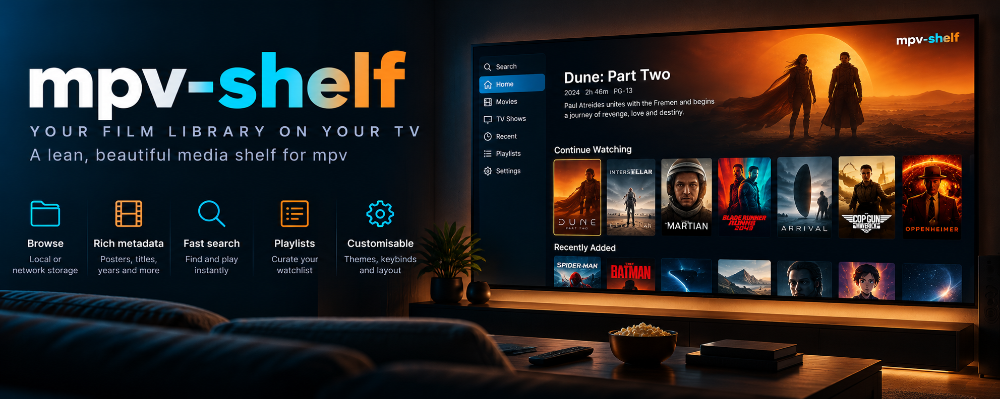
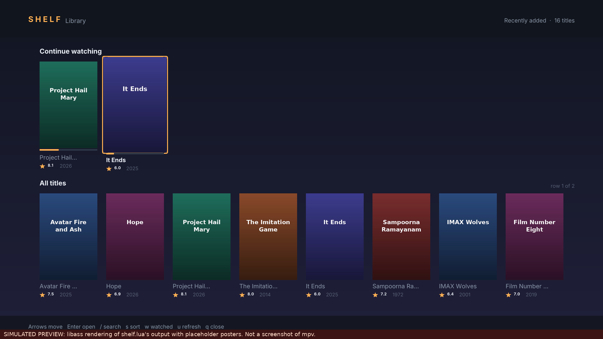
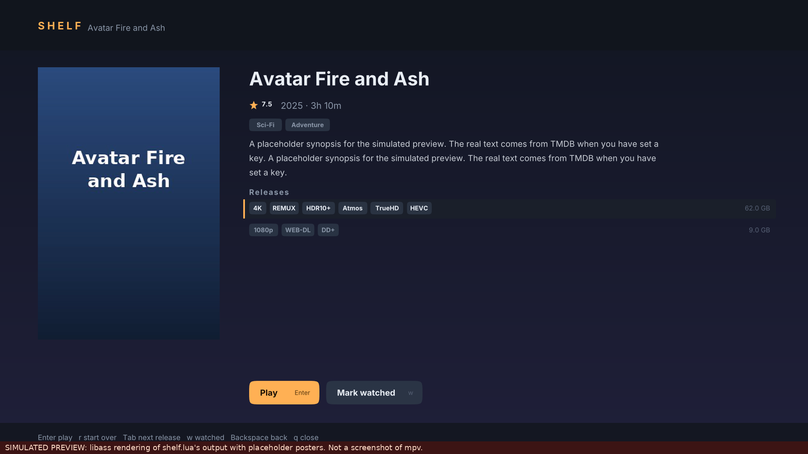

# mpv-shelf



*Illustration, not a screenshot. The screen, the sidebar and every poster in it are made up for the picture, and some of what it shows is not in version 1: playlists, themes, a Settings page, the sidebar and the large hero banner do not exist (only an accent colour, the number of columns and a few behaviours are configurable; see "Options"). What works today is described in the text below.*

> **Part of the [Software Defined Home Theatre](https://github.com/praveenchandrahas/Software-Defined-Home-Theatre) project.** The main repository holds the documentation, build log, results and the installer checks; this is one of its parts. Sibling repositories: [linux-theater-dsp](https://github.com/praveenchandrahas/linux-theater-dsp) (router and CamillaDSP configs) · [mpv-object-audio](https://github.com/praveenchandrahas/mpv-object-audio) (player and Atmos wrapper) · [Roomtone](https://github.com/praveenchandrahas/Roomtone) (measurement, autocal, status page, mpv overlay) · [seekthumbs](https://github.com/praveenchandrahas/seekthumbs) (seek-bar thumbnails).

A Netflix-style film browser for [mpv](https://mpv.io), over a **local folder** such as a debrid/WebDAV mount. Posters, ratings and quality chips, a Continue Watching row, search, TV seasons, and it remembers where you stopped.




> **These two images are simulations, not screenshots.** They are libass renderings of what `shelf.lua` asks mpv to draw, with placeholder posters (`tools/make_preview.py`). How it really looks and feels in mpv is **not yet verified**.

## Status: v1, tested only against a mocked mpv

| Part | What was tested | How |
|---|---|---|
| `shelf-index` (names to catalog, grouping, TMDB, posters, incremental refresh, offline/bad-key behaviour) | Yes | unit tests with real release names and a fake network |
| `shelf.lua` logic (navigation, search, sort, resume, history, playback commands, no overlapping posters, nothing drawn into the footer at several window sizes) | Yes | tests under a **mock** of mpv's Lua API (lupa) |
| `install-shelf.sh` | Yes | throwaway `HOME`, run twice, remove |
| **Real mpv**: poster bitmaps (`overlay-add`) layering with the ASS text, keyboard capture, mouse, `mp.input` search, `loadfile ... start=` | **No** | needs your first run; see "If something looks wrong" |
| Real TMDB responses | **No** | only mocked JSON shapes |

**2026-10-28:** the owner reports it fully set up and working on his rig (TMDB key in his own config, `shelf-index scan` run, the tests run); the table above has not been re-scored from that, and no details were recorded.

**2026-10-27, first use on the owner's machine:** installed into both mpv config folders; the scan found 635 files = 195 entries (187 films, 8 shows). The first TMDB run was cut short after 9 titles by one dropped TLS handshake (`UNEXPECTED_EOF_WHILE_READING`, common on some ISPs): a dropped connection is now retried 3 times and a title that still fails is skipped (the scan only gives up after 3 in a row). The owner confirmed the same evening that **Ctrl+b opens the shelf in real mpv** (the rest of the first run, posters and playback from a card, has not been reported yet).

Needs mpv 0.38 or newer (search uses `mp.input`; resume uses `loadfile ... -1 start=N`), `python3`, and `ffmpeg` for posters.

## What it is, and what it is not

* It **reads** your library folder (directory listing and `stat` only, never file contents) and **never writes** to it. Everything it creates lives in `~/.local/share/mpv-shelf`.
* It plays by the **real file path**, so other things that key on the path keep working: [seekthumbs](https://github.com/praveenchandrahas/seekthumbs) thumbnails, a launcher wrapper such as `mpv-atmos`, profile detection.
* One card per film: releases of the same title and year are **one card** with a release picker (best first: resolution, REMUX, size). A name with no year is never merged with anything.
* It is not a media server: no transcoding, no remote access, no multi-user.

## Setup, step by step

```bash
# 1. get it
cd ~/sdht-workspace/mpv-shelf             # wherever this folder lives

# 2. see what it would show, no writes, no network
python3 shelf-index plan | head -40
python3 shelf-index plan | tail -1

# 3. install (only touches ~/.local/bin and your mpv config; safe to run again)
./install-shelf.sh

# 4. optional but recommended: posters and ratings (see "TMDB key" below)
nano ~/.config/seekthumbs/config.ini        # add the [shelf] block shown below

# 5. build the catalog (first run is the slow one; Ctrl+C is safe, it resumes)
shelf-index scan
shelf-index status

# 6. open any film with mpv, then press Ctrl+b
mpv /mnt/decypharr/__all__/some-film.mkv
```

`library` is read from `~/.config/seekthumbs/config.ini`, so if seekthumbs already works for you there is nothing to repeat. To use a different folder or file, put a `[shelf]` section there:

```ini
[shelf]
library = /mnt/decypharr/__all__
min_size_mb = 0            ; 0 = every video file
tmdb_key = PASTE_KEY_HERE
network = yes
```

Lookup order for each setting: `[shelf]`, then `[seekthumbs]`, then the default. So with no `[shelf] min_size_mb`, the seekthumbs value (for example 20000 MB) applies and small files are hidden. Set `min_size_mb = 0` under `[shelf]` to see everything.

Skipped on purpose: anything that is not a video file (`.iso`, `.rar`, `.nfo`, subtitles and so on).

### TMDB key (free)

1. Make an account at themoviedb.org, then open Settings, API.
2. Request a key for personal use. You get an **API Key** (32 hex characters) and a **Read Access Token** (starts with `eyJ`). Either works; paste one as `tmdb_key`.
3. Without a key, everything works: cards show titles and quality chips, no posters, ratings or synopsis.

This product uses the TMDB API but is not endorsed or certified by TMDB. Posters are cached once in `~/.local/share/mpv-shelf/posters`; requests are throttled (about 4 a second) and retried on rate limits. A film TMDB does not know is retried after a week.

## Using it

`Ctrl+b` opens and closes it (the installer adds `Ctrl+b script-binding shelf/open` to `input.conf`, between marked comment lines; if you already use that key it tells you and changes nothing).

| Key | Does |
|---|---|
| arrows | move; the selected card grows and gets an outline |
| Enter | open a title; on a title, play the selected release (resumes if you stopped part way) |
| r | play from the start |
| Tab / Shift+Tab | next / previous release of a film |
| `/` | search (type, Enter; Esc clears it) |
| s | sort: recently added, title, year, rating |
| w | mark watched / unwatched |
| u | rebuild the catalog now (in the background) |
| Esc / Backspace | back; on the home screen, closes |
| q | close |
| mouse | hover, click, wheel |

TV: a show page lists seasons and episodes; Enter plays the episode and queues the rest of the season (and later seasons) as the playlist. A finished episode makes "next" appear under Continue Watching.

History is kept in `~/.local/share/mpv-shelf/history.json` (mpv's own watch-later is not used). A film counts as watched at 92%; stopped before 60 s it is not offered under Continue Watching.

### Options

`~/.config/mpv/script-opts/shelf.conf` (the installer never overwrites it; the shipped defaults sit next to it as `shelf.conf.default`):

`data_dir`, `indexer`, `python`, `ffmpeg`, `cols` (8), `max_posters` (28), `refresh_hours` (6), `resume_min_s` (60), `watched_pct` (92), `pause_on_open` (no), `hide_video_when_open` (no), `accent` (FFB054).

The catalog is rebuilt in the background by mpv when it is older than `refresh_hours`; the open browser notices the new file within 5 seconds.

## Relation to seekthumbs

Separate repo, separate job: seekthumbs makes the seek-bar thumbnails, mpv-shelf is the browser. They share the library setting and nothing else. Because mpv-shelf plays the real path, thumbnails appear for films you start from the shelf exactly as when you start them from the command line.

## If something looks wrong (first run in real mpv)

Run `mpv --msg-level=shelf=v,all=warn FILE` and look for `shelf:` lines and Lua errors. The likely candidates, because they are the parts a mock cannot show:

* **Posters invisible or text drawn over them**: the layering of bitmap overlays versus ASS text differs by mpv build. Nothing is drawn *under* a poster by design, so the worst case should be missing posters, not garbled text. Report what you see.
* **Keys still reach the video** while open: some builds ignore forced bindings for a key already bound in `input.conf`.
* **Search does nothing**: needs mpv 0.38+ (`mp.input`).
* **Layout too big/small**: lower `cols`, or report the window size.

## Limitations

* Posters are bitmaps shown above the video; with `vo` settings that do not support `overlay-add` they will not appear (cards fall back to titles).
* Title matching is by name. A badly named file can land on the wrong TMDB film; the card shows TMDB's title, so a wrong one is visible. There is no manual override yet.
* Season posters, episode titles and per-episode artwork are not fetched.
* No subtitle/audio track chooser: use mpv's own.
* Windows and macOS are untested (paths use `/`).

## Development

```bash
pip install lupa            # and have ffmpeg installed
tests/run.sh                # 68 tests
python3 tools/make_preview.py   # redraws docs/img/preview-*.png
```

Apache-2.0; see LICENSE and NOTICE. No code was taken from other projects.

Part of the [software-defined home theatre](https://github.com/praveenchandrahas/Software-Defined-Home-Theatre) project.
