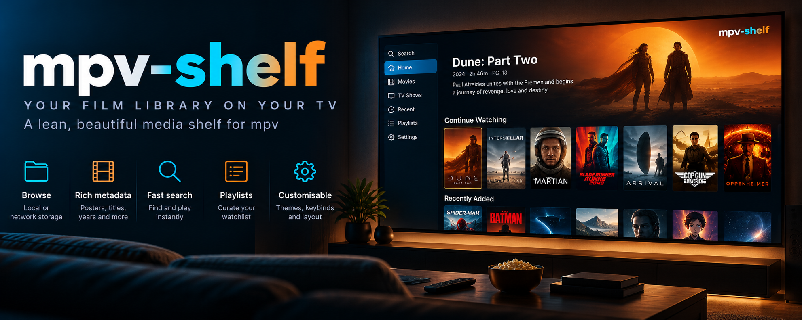
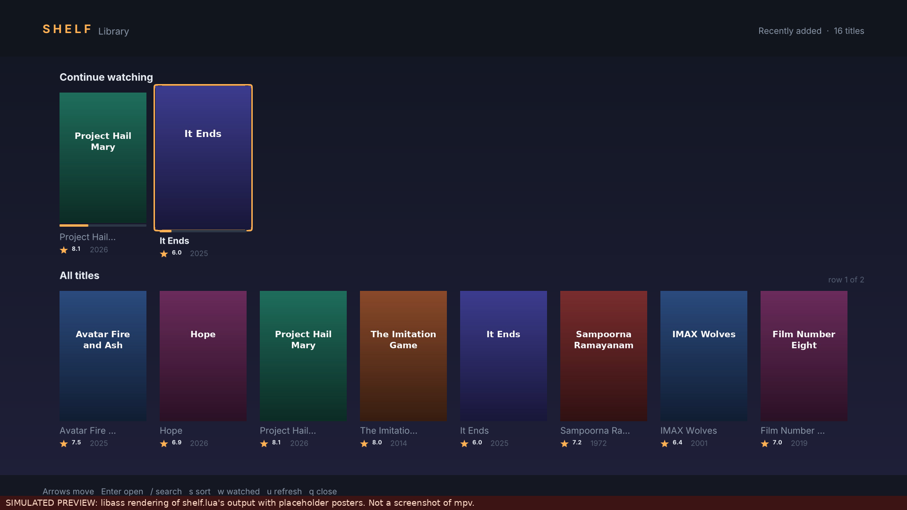
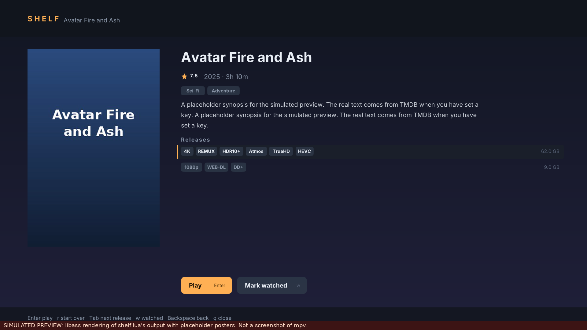

# mpv-shelf

[](https://github.com/praveenchandrahas/mpv-shelf/actions/workflows/ci.yml) *(CI = unit tests, lint, and a package install/remove test in a clean Ubuntu 24.04 container. A green badge does not show the software works on a real rig.)*



*Illustration, not a screenshot. The screen, the sidebar and every poster in it are made up for the picture, and some of what it shows is not in version 1: playlists, themes, a Settings page, the sidebar and the large hero banner do not exist (only an accent colour, the number of columns and a few behaviours are configurable; see "Options"). What works today is described in the text below.*

> **Part of the [Software Defined Home Theatre](https://github.com/praveenchandrahas/Software-Defined-Home-Theatre) project.** The main repository holds the documentation, build log, results and the installer checks; this is one of its parts. Sibling repositories: [linux-theater-dsp](https://github.com/praveenchandrahas/linux-theater-dsp) (router and CamillaDSP configs) · [mpv-object-audio](https://github.com/praveenchandrahas/mpv-object-audio) (player and Atmos wrapper) · [Roomtone](https://github.com/praveenchandrahas/Roomtone) (measurement, autocal, status page, mpv overlay) · [seekthumbs](https://github.com/praveenchandrahas/seekthumbs) (seek-bar thumbnails).

A Netflix-style film browser for [mpv](https://mpv.io), over a **local folder** such as a debrid/WebDAV mount. Posters, ratings and quality chips, a Continue Watching row, search, TV seasons, and it remembers where you stopped.

**Full docs:** https://praveenchandrahas.github.io/mpv-shelf/ — install and usage.




> **These two images are simulations, not screenshots.** They are libass renderings of what `shelf.lua` asks mpv to draw, with placeholder posters (`tools/make_preview.py`). How it really looks and feels in mpv is **not yet verified**.

## Install (pre-release, experimental)

Releases are marked **pre-release** on the [releases page](https://github.com/praveenchandrahas/mpv-shelf/releases). Download the `.deb` and `SHA256SUMS` from one release, check, then install:

```sh
sha256sum -c --ignore-missing SHA256SUMS
sudo apt install ./mpv-shelf_0.1.0_all.deb
mpv-shelf-setup --dry-run   # then: mpv-shelf-setup install
```

Needs mpv with Lua and ffmpeg.

The package puts files under `/usr` only. Its install and remove scripts do not enable or start services, do not write into any home folder, and do not touch CamillaDSP or PipeWire configuration; the setup command above does the per-user part, and `--dry-run` shows what it would do first. Details, the other repositories' packages, and the one-command installer are in the main repository's [packaging notes](https://github.com/praveenchandrahas/Software-Defined-Home-Theatre/blob/main/docs/packaging.md).

What was checked: written with an AI assistant; checked against simulated rooms and REW exports; used and checked by the author in his own room (one room, one author). No external or second-person validation yet. The packages are unsigned. CI installs and removes them in clean Ubuntu 24.04; the packaging itself has not been run on the author's own rig.

## Status: v1, tested only against a mocked mpv

| Part | What was tested | How |
|---|---|---|
| `shelf-index` (names to catalog, grouping, TMDB, posters, incremental refresh, offline/bad-key behaviour) | Yes | unit tests with real release names and a fake network |
| `shelf.lua` logic (navigation, search, sort, resume, history, playback commands, no overlapping posters, nothing drawn into the footer at several window sizes) | Yes | tests under a **mock** of mpv's Lua API (lupa) |
| `install-shelf.sh` | Yes | throwaway `HOME`, run twice, remove |
| **Real mpv**: poster bitmaps (`overlay-add`) layering with the ASS text, keyboard capture, mouse, `mp.input` search, `loadfile ... start=` | **No** | needs your first run; see "If something looks wrong" |
| Real TMDB responses | **No** | only mocked JSON shapes |

**2026-10-28:** the owner reports it fully set up and working on his rig (TMDB key in his own config, `shelf-index scan` run, the tests run); the table above has not been re-scored from that, and no details were recorded.

**2026-10-27, first use on the owner's machine:** installed into both mpv config folders; the scan found 635 files = 195 entries (187 films, 8 shows). The first TMDB run was cut short after 9 titles by one dropped TLS handshake (`UNEXPECTED_EOF_WHILE_READING`, common on some ISPs): a dropped connection is now retried 3 times and a title that still fails is skipped (the scan only gives up after 3 in a row). The owner confirmed the same evening that **Ctrl+b opens the shelf in real mpv** (the rest of the first run, posters and playback from a card, has not been reported yet).

Needs mpv 0.38 or newer (search uses `mp.input`; resume uses `loadfile ... -1 start=N`), `python3`, and `ffmpeg` for posters.

## What it is, and what it is not

* It **reads** your library folder (directory listing and `stat` only, never file contents) and **never writes** to it. Everything it creates lives in `~/.local/share/mpv-shelf`.
* It plays by the **real file path**, so other things that key on the path keep working: [seekthumbs](https://github.com/praveenchandrahas/seekthumbs) thumbnails, a launcher wrapper such as `mpv-atmos`, profile detection.
* One card per film: releases of the same title and year are **one card** with a release picker (best first: resolution, REMUX, size). A name with no year is never merged with anything.
* It is not a media server: no transcoding, no remote access, no multi-user.

## Setup, step by step

The full setup walkthrough (getting the files, the TMDB key, building the catalog) is in the docs: [Install](https://praveenchandrahas.github.io/mpv-shelf/install/).

Short version:

```bash
cd ~/sdht-workspace/mpv-shelf             # wherever this folder lives
./install-shelf.sh                        # only touches ~/.local/bin and your mpv config
shelf-index scan                          # build the catalog (Ctrl+C is safe, it resumes)
mpv /mnt/decypharr/__all__/some-film.mkv  # then press Ctrl+b
```

## Using it

`Ctrl+b` opens and closes it. See [Usage](https://praveenchandrahas.github.io/mpv-shelf/usage/) for the full key reference, options, and troubleshooting.

## Relation to seekthumbs

Separate repo, separate job: seekthumbs makes the seek-bar thumbnails, mpv-shelf is the browser. They share the library setting and nothing else. Because mpv-shelf plays the real path, thumbnails appear for films you start from the shelf exactly as when you start them from the command line.

## Limitations

* Posters are bitmaps shown above the video; with `vo` settings that do not support `overlay-add` they will not appear (cards fall back to titles).
* Title matching is by name. A badly named file can land on the wrong TMDB film; the card shows TMDB's title, so a wrong one is visible. There is no manual override yet.
* Season posters, episode titles and per-episode artwork are not fetched.
* No subtitle/audio track chooser: use mpv's own.
* Windows and macOS are untested (paths use `/`).

## Development

```bash
pip install lupa            # and have ffmpeg installed
tests/run.sh                # 68 tests
python3 tools/make_preview.py   # redraws docs/img/preview-*.png
```

Apache-2.0; see LICENSE and NOTICE. No code was taken from other projects.

Part of the [software-defined home theatre](https://github.com/praveenchandrahas/Software-Defined-Home-Theatre) project.
