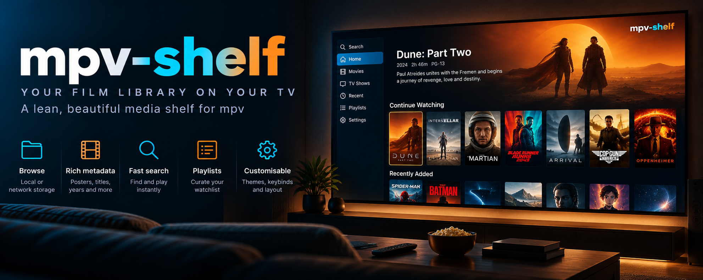

# mpv-shelf

*Illustration, not a screenshot. The screen, the sidebar and every poster in it are made up for the picture, and some of what it shows is not in version 1: playlists, themes, a Settings page, the sidebar and the large hero banner do not exist (only an accent colour, the number of columns and a few behaviours are configurable; see [Options](usage.md#options)). What works today is described in the text below.*

A Netflix-style film browser for [mpv](https://mpv.io), over a **local folder** such as a debrid/WebDAV mount. Posters, ratings and quality chips, a Continue Watching row, search, TV seasons, and it remembers where you stopped.

It is part of the [Software Defined Home Theatre](https://github.com/praveenchandrahas/Software-Defined-Home-Theatre) project. The main repository holds the documentation, build log, results and the installer checks; mpv-shelf is one of its parts.

## What it is, and what it is not

* It **reads** your library folder (directory listing and `stat` only, never file contents) and **never writes** to it. Everything it creates lives in `~/.local/share/mpv-shelf`.
* It plays by the **real file path**, so other things that key on the path keep working: [seekthumbs](https://github.com/praveenchandrahas/seekthumbs) thumbnails, a launcher wrapper such as `mpv-atmos`, profile detection.
* One card per film: releases of the same title and year are **one card** with a release picker (best first: resolution, REMUX, size). A name with no year is never merged with anything.
* It is not a media server: no transcoding, no remote access, no multi-user.

## Status: v1, tested only against a mocked mpv

| Part | What was tested | How |
|---|---|---|
| `shelf-index` (names to catalog, grouping, TMDB, posters, incremental refresh, offline/bad-key behaviour) | Yes | unit tests with real release names and a fake network |
| `shelf.lua` logic (navigation, search, sort, resume, history, playback commands, no overlapping posters, nothing drawn into the footer at several window sizes) | Yes | tests under a **mock** of mpv's Lua API (lupa) |
| `install-shelf.sh` | Yes | throwaway `HOME`, run twice, remove |
| **Real mpv**: poster bitmaps (`overlay-add`) layering with the ASS text, keyboard capture, mouse, `mp.input` search, `loadfile ... start=` | **No** | needs your first run; see [Usage](usage.md#if-something-looks-wrong-first-run-in-real-mpv) |
| Real TMDB responses | **No** | only mocked JSON shapes |

**2026-10-28:** the owner reports it fully set up and working on his rig (TMDB key in his own config, `shelf-index scan` run, the tests run); the table above has not been re-scored from that, and no details were recorded.

**2026-10-27, first use on the owner's machine:** installed into both mpv config folders; the scan found 635 files = 195 entries (187 films, 8 shows). The first TMDB run was cut short after 9 titles by one dropped TLS handshake (`UNEXPECTED_EOF_WHILE_READING`, common on some ISPs): a dropped connection is now retried 3 times and a title that still fails is skipped (the scan only gives up after 3 in a row). The owner confirmed the same evening that **Ctrl+b opens the shelf in real mpv** (the rest of the first run, posters and playback from a card, has not been reported yet).

Needs mpv 0.38 or newer (search uses `mp.input`; resume uses `loadfile ... -1 start=N`), `python3`, and `ffmpeg` for posters.

## Next

* [Install](install.md) — getting the package in, the TMDB key, and building the catalog.
* [Usage](usage.md) — opening the shelf, keys, options, and what to do if something looks wrong.
