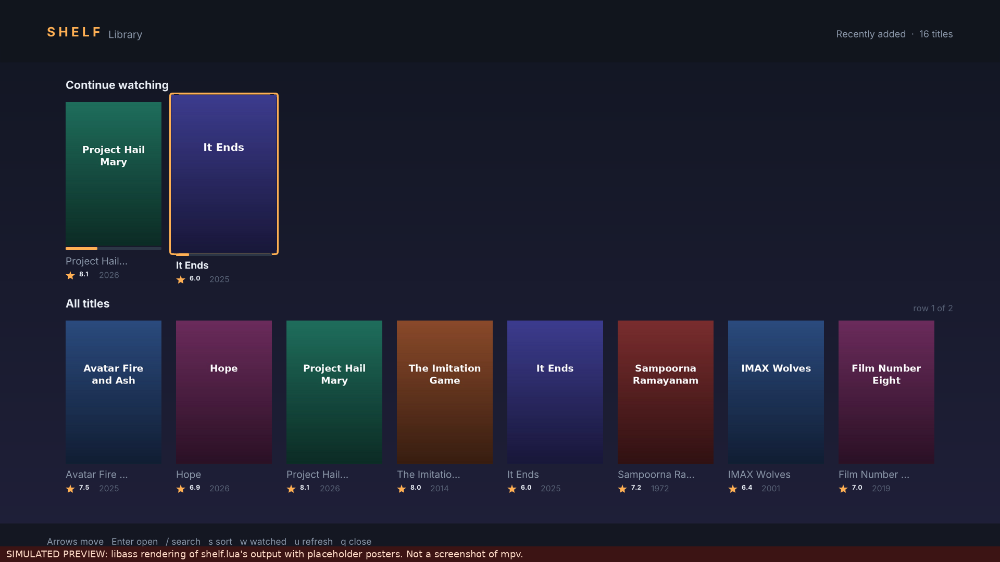
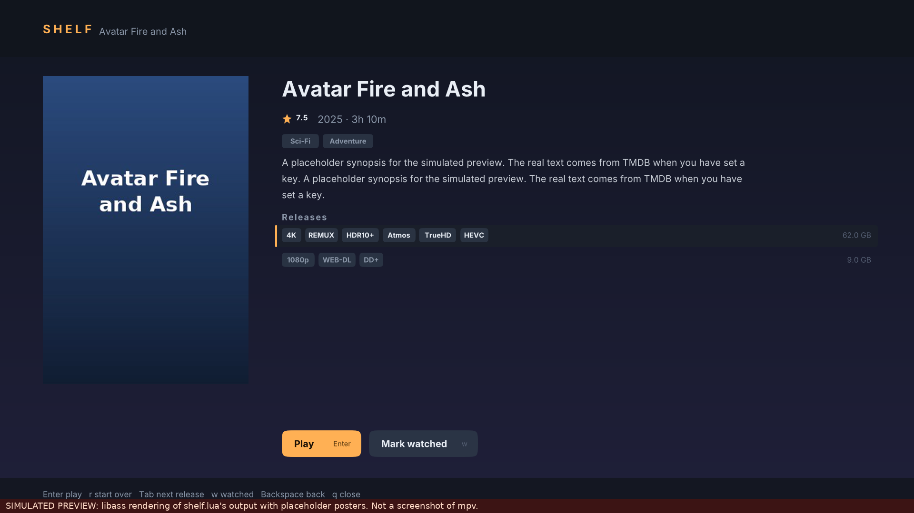

# Usage

> **These two images are simulations, not screenshots.** They are libass renderings of what `shelf.lua` asks mpv to draw, with placeholder posters (`tools/make_preview.py`). How it really looks and feels in mpv is **not yet verified**.

`Ctrl+b` opens and closes it (the installer adds `Ctrl+b script-binding shelf/open` to `input.conf`, between marked comment lines; if you already use that key it tells you and changes nothing).

| Key | Does |
|---|---|
| arrows | move; the selected card grows and gets an outline |
| Enter | open a title; on a title, play the selected release (resumes if you stopped part way) |
| r | play from the start |
| Tab / Shift+Tab | next / previous release of a film |
| `/` | search (type, Enter; Esc clears it) |
| s | sort: recently added, title, year, rating |
| w | mark watched / unwatched |
| u | rebuild the catalog now (in the background) |
| Esc / Backspace | back; on the home screen, closes |
| q | close |
| mouse | hover, click, wheel |

TV: a show page lists seasons and episodes; Enter plays the episode and queues the rest of the season (and later seasons) as the playlist. A finished episode makes "next" appear under Continue Watching.

History is kept in `~/.local/share/mpv-shelf/history.json` (mpv's own watch-later is not used). A film counts as watched at 92%; stopped before 60 s it is not offered under Continue Watching.

## Options

`~/.config/mpv/script-opts/shelf.conf` (the installer never overwrites it; the shipped defaults sit next to it as `shelf.conf.default`):

`data_dir`, `indexer`, `python`, `ffmpeg`, `cols` (8), `max_posters` (28), `refresh_hours` (6), `resume_min_s` (60), `watched_pct` (92), `pause_on_open` (no), `hide_video_when_open` (no), `accent` (FFB054).

The catalog is rebuilt in the background by mpv when it is older than `refresh_hours`; the open browser notices the new file within 5 seconds.

## If something looks wrong (first run in real mpv)

Run `mpv --msg-level=shelf=v,all=warn FILE` and look for `shelf:` lines and Lua errors. The likely candidates, because they are the parts a mock cannot show:

* **Posters invisible or text drawn over them**: the layering of bitmap overlays versus ASS text differs by mpv build. Nothing is drawn *under* a poster by design, so the worst case should be missing posters, not garbled text. Report what you see.
* **Keys still reach the video** while open: some builds ignore forced bindings for a key already bound in `input.conf`.
* **Search does nothing**: needs mpv 0.38+ (`mp.input`).
* **Layout too big/small**: lower `cols`, or report the window size.

## Limitations

* Posters are bitmaps shown above the video; with `vo` settings that do not support `overlay-add` they will not appear (cards fall back to titles).
* Title matching is by name. A badly named file can land on the wrong TMDB film; the card shows TMDB's title, so a wrong one is visible. There is no manual override yet.
* Season posters, episode titles and per-episode artwork are not fetched.
* No subtitle/audio track chooser: use mpv's own.
* Windows and macOS are untested (paths use `/`).
